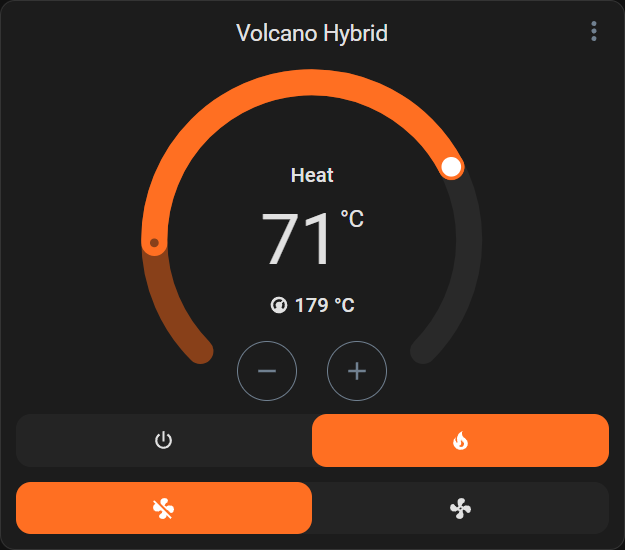

# Home Assistant Volcano Hybrid
[![hacs][hacs_badge]][hacs_url]
[![Validate][validate_badge]][validate_url]

[![gh_latest_release_badge]][gh_latest_release_url] 
![gh_release_date_badge]
[![gh_issues_badge]][gh_issues_url]

A Storz & Bickel integration for Home Assistant using Bluetooth: Volcano Hybrid, Crafty / Crafty+, Venty and Veazy. Allows controlling core features via a single climate entity.

## Installing

Install using HACS (click the button below if you have it installed), or download the repository and put the folder from `custom-components` in your `config/custom_components` folder.

## Supported devices

| Device | Tested on hardware | Notes |
| --- | --- | --- |
| Volcano Hybrid | yes | — |
| Crafty+ | **no** | decoded from the vendor app; monitor-only below firmware V02.51 |
| Crafty | **no** | decoded from the vendor app; monitor-only below firmware V02.51 |
| Venty | **no** | polled every second while connected |
| Veazy | **no** | polled every second while connected |

If you own one of the untested devices, please open an issue with the diagnostics download — that is how these become tested.

## Quick start

- Add the integration
- Power on your device (Volcano Hybrid, Crafty, Venty or Veazy)
- If you have BLE adapters configured the device should be discovered automatically
- Add it when it's found and start using the climate entity (for a Volcano Hybrid that is `climate.volcano_hybrid`).

## Usage

Every device gets a `climate` entity; the rest are sensors, switches, numbers and buttons, and most of the configuration and diagnostic ones are disabled by default. The sections below list what each device offers.

### Volcano Hybrid

This integration adds a `climate` entity to control the Volcano Hybrid:

It shows the following information and allows these controls:
- Current temperature (read-only)
- Target temperature
- Set directly or increase value in 1 degree steps
- Enable/disable heating
- Enable/disable fan
- Whether it is heating up, holding temperature, or cooling down after being switched off (the `hvac_action` attribute: the card shows *Heating* while it works towards the target, *Heat* once it is holding, and *Idle* while it cools with its display still lit)

There is also a **Ready** binary sensor, which is on once the vaporizer reports it reached the target temperature. It is the device's own "temperature reached" signal passed through unchanged, which is what makes it the right thing to wait on: it is the same signal that drives the device's vibration alert, so it turns on exactly when the Volcano tells you it is ready.

Being the device's own signal, it also inherits the device's idea of "reached": a target change of 2 °C or less never turns it off, and it stays on while the device coasts down after you lower the target or switch the heater off. For "is it actually working towards the target right now", use `hvac_action` instead.

Additionally, there are the following configuration/diagnostic entities:
- The auto off time setting (configurable)
- Led brightness (configurable)
- Whether the device is showing temperature in Celsius or Fahrenheit (configurable)
- Whether vibration is enabled (configurable)
- The total heating time
- Whether the auto off timer is enabled (this arms when the target temperature is reached)
- Whether the heater is running and whether the pump is running
- A heater/pump fault sensor (the device reports a timing fault in its heater control, which stops both the heater and the pump)
- Whether the device is in its service/burn-in mode (it heats itself to 230 °C for ten minutes)
- The raw status registers 1/2/3 and error history 1/2, as hex, for diagnosing faults (see [the BLE spec](VOLCANO_BLE_SPEC.md)), plus status registers 4/5 — the device's two remaining status words, which nothing decodes yet and which stay empty on a device that does not report them
- A last fault sensor, which reads that error history rather than reprinting it: it names the newest fault the device logged, and its attributes carry the rest of the log both decoded and raw
- The device connected state
- A reconnect button (connects immediately)
- A delayed reconnect button (disconnects, then reconnects after a short delay so a better Bluetooth path can be chosen)
- An auto-connect switch (enable/disable automatic connecting; see [Connecting](#connecting))
- The rssi from the last ble message

Most of these are disabled by default; enable them under the device page in **Settings** → **Devices & services**.

### Crafty / Crafty+

Experimental, untested on hardware. The `climate` entity sets the target temperature and switches the heater; there is no fan, so no fan modes. Entities:
- Battery (sensor)
- Auto off countdown (sensor)
- Total heat time (sensor)
- Ready (binary sensor, on once the target temperature is reached)
- Heater running (binary sensor)
- Boost and Superboost (binary sensors)
- Error and Needs factory reset (binary sensors)
- Find mode active (binary sensor)
- Boost temperature (configurable)
- LED Brightness (configurable)
- Auto off time (configurable)
- Vibration enabled (configurable)
- Charge LED (configurable)
- Automatic Bluetooth shutdown (configurable; see [Sleeping devices](#sleeping-devices))
- Find device (button, makes the device buzz)
- Status register 1/2, System status and Battery status 1/2 as hex, for diagnosing faults (see [the Crafty spec](CRAFTY_BLE_SPEC.md))
- The device connected state, signal strength and connected address, the reconnect buttons and the auto-connect switch, as on the Volcano

Below firmware V02.51 the Crafty does not expose its settings characteristics, so there the integration can only monitor and control the temperature and heater. There is no firmware update entity for the Crafty.

### Venty / Veazy

Experimental, untested on hardware. The `climate` entity sets the target temperature and switches the heater; there is no fan, so no fan modes. Entities:
- Battery (sensor)
- Auto off countdown (sensor)
- Heater mode (sensor)
- Total heat time and Total charging time (sensors)
- Colour (sensor, Veazy only)
- Ready (binary sensor)
- Heater running and Charging (binary sensors)
- Boost and Superboost (binary sensors)
- Target changed on device (binary sensor)
- Bootloader mode (binary sensor; while the device is in its bootloader it is reported but never controlled)
- Permanent Bluetooth (Venty: binary sensor; Veazy: switch, see [Sleeping devices](#sleeping-devices))
- Boost temperature and Superboost temperature (configurable)
- Display brightness (configurable)
- Showing celsius (configurable)
- Vibration enabled (configurable)
- Charge optimization and Charge limit (configurable)
- Boost visualization (configurable)
- Boost timeout disabled (configurable)
- Find device (button)
- Firmware (update entity; it reports the installed version, no newer version is known yet)
- The device connected state, signal strength and connected address, the reconnect buttons and the auto-connect switch, as on the Volcano

These devices are polled every second while connected (see [the Venty spec](VENTY_BLE_SPEC.md)).

## How the device is controlled

The Crafty and Venty/Veazy protocols are documented in [**CRAFTY_BLE_SPEC.md**](CRAFTY_BLE_SPEC.md) and [**VENTY_BLE_SPEC.md**](VENTY_BLE_SPEC.md). The Volcano Hybrid Bluetooth protocol is documented in [**VOLCANO_BLE_SPEC.md**](VOLCANO_BLE_SPEC.md): every service and characteristic, how the values are encoded, the meaning of each bit in the status registers, and the firmware-update protocol (which this integration deliberately does not implement).

## Warning

### Do not leave the device unattended while using the integration

That being said, there are some safety measures:
- Temperature commands **WILL** be retried every second (while the device is on) when they don't appear to get set
- On-commands (fan-on, heater-on) **WON'T** be retried. If they fail, they fail.
- Off-commands **WILL** be retried (as long as the device is on, but if they fail, it will be on)

This will however not protect you from losing control when bluetooth fails, so _do not leave the device unattended while using the integration_.

## Connecting

By default this integration connects to a device as soon as it sees one (after it has been set up).
This means updates from the device trigger updates in Home Assistant instantly, but it also means no other Bluetooth client can control the device while Home Assistant holds the connection (the Volcano stops advertising once connected).
The portable devices sleep when idle, so they are connected when they wake up; see [Sleeping devices](#sleeping-devices).

You can control this behavior:

- **Auto connect** switch — turn it off to release the device so the official app or another Bluetooth client can connect. Commands you send from Home Assistant (and the reconnect buttons) still connect on demand. Turn it back on to resume automatic connecting. The setting is remembered across restarts.
- **(Re)connect** button — connects immediately.
- **(Re)connect after delay** button — disconnects and reconnects after the configured delay, leaving time for a fresh advertisement so the strongest Bluetooth proxy can take the connection.

### Sleeping devices

The portable devices (Crafty, Venty, Veazy) switch Bluetooth off when idle to save battery. Their entities show *unavailable* until the device wakes and advertises again, at which point the integration connects as usual. The *Automatic Bluetooth shutdown* setting (Crafty) and *Permanent Bluetooth* (Veazy) change that, at the cost of battery life.

### Configuration

The connect timing is configurable via the integration's options (**Settings** → **Devices & services** → **Storz & Bickel** → **Configure**):

- **Auto-connect delay** (default `1` second) — how long to wait after seeing the device before connecting automatically. A short wait lets every Bluetooth proxy report the advertisement so the best path is chosen instead of the first one to see it. Keep this low.
- **Delayed reconnect delay** (default `11` seconds) — how long the *(Re)connect after delay* button stays disconnected before reconnecting. The Volcano advertises roughly every 10 seconds while idle, so the default guarantees at least one fresh advertisement.

## Troubleshooting

### The device is not discovered

- Volcano: make sure it is plugged in; its Bluetooth stays available even when the heater and fan are off.
- Crafty, Venty and Veazy: wake the device (switch it on or press a button) so it advertises; they switch Bluetooth off when idle, see [Sleeping devices](#sleeping-devices).
- Make sure a [Bluetooth adapter or ESPHome Bluetooth proxy](https://www.home-assistant.io/integrations/bluetooth/) is set up in Home Assistant and within range of the device.
- The official Storz & Bickel app (or any other Bluetooth client) may be holding the connection. Close the app and try again.

### The entities show as unavailable

The Bluetooth connection to the device was lost. The integration reconnects automatically as soon as the device is seen again (unless the `Auto connect` switch is off — see [Connecting](#connecting)); the diagnostic `Connected` binary sensor and `Signal strength` sensor (disabled by default) can help spot range issues. Pressing the `(Re)connect` button forces a new connection attempt.

### Commands fail with "the device is not connected"

The command could not be delivered because the device is currently disconnected. Wait for it to reconnect (or press the `(Re)connect` button) and try again.

## Removing the integration

This integration follows standard integration removal:

1. Go to **Settings** → **Devices & services** and select the **Storz & Bickel** integration.
2. Open the three-dot menu of the config entry and select **Delete**.

After removal the device keeps working standalone; no settings on the device itself need to be reset. If you installed through HACS you can then also remove the repository from HACS.

# Example usage

Ready-made dashboards, scripts (fill a bag, hands-free bag and whip sessions, party rounds), automations and temperature ladders live on the examples site, most of them as blueprints you can import with one click:

[validate_url]: https://github.com/SavageNL/home-assistant-volcano-hybrid/actions/workflows/validate.yml
[validate_badge]: https://github.com/SavageNL/home-assistant-volcano-hybrid/actions/workflows/validate.yml/badge.svg
[hacs_url]: https://github.com/hacs/integration
[hacs_badge]: https://img.shields.io/badge/HACS-Default-orange.svg
[gh_latest_release_badge]: https://img.shields.io/github/v/release/SavageNL/home-assistant-volcano-hybrid
[gh_latest_release_url]: https://github.com/SavageNL/home-assistant-volcano-hybrid/releases
[gh_release_date_badge]: https://img.shields.io/github/release-date/SavageNL/home-assistant-volcano-hybrid
[gh_issues_badge]: https://img.shields.io/github/issues/SavageNL/home-assistant-volcano-hybrid
[gh_issues_url]: https://github.com/SavageNL/home-assistant-volcano-hybrid/issues
