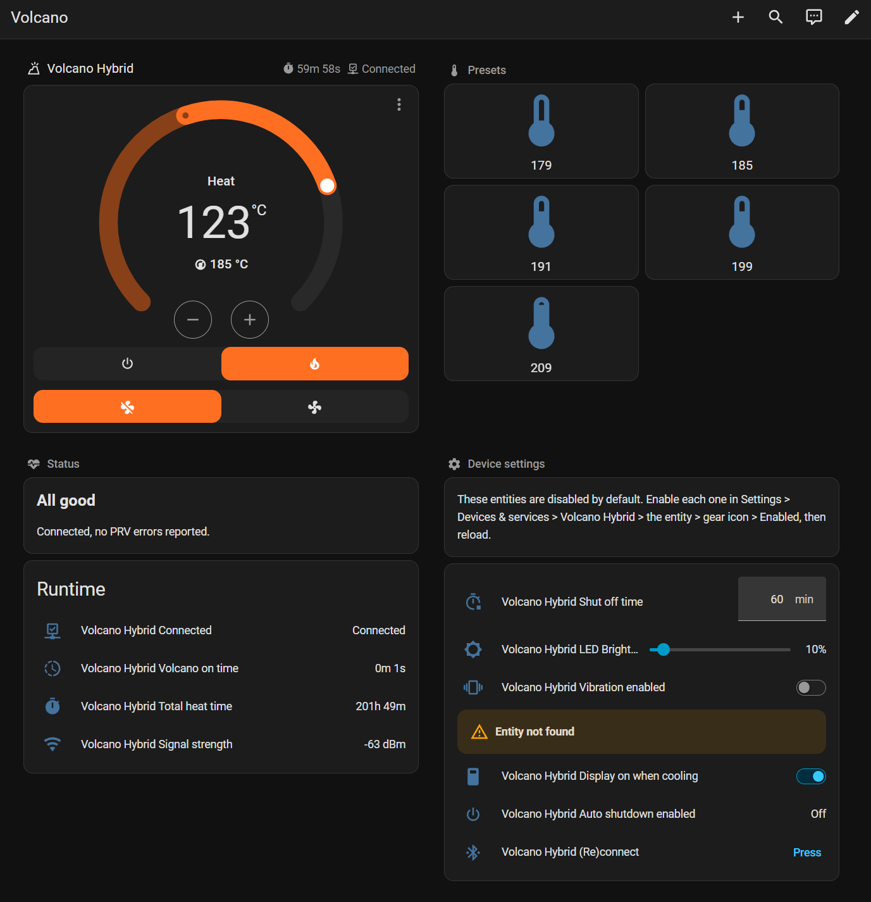
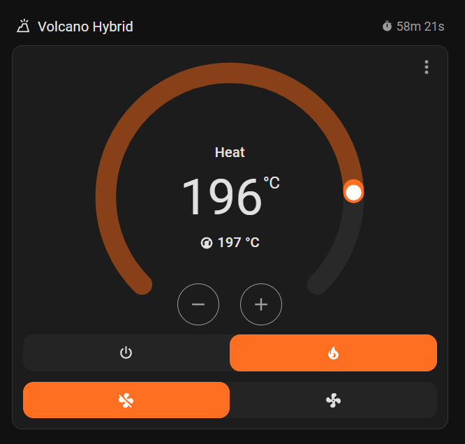
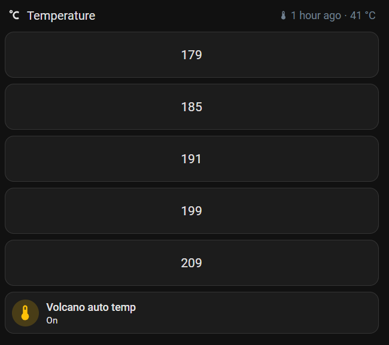

# Dashboards

Paste these into a dashboard's raw configuration editor (or a card's YAML editor). The entity ids assume the default device name, `volcano_hybrid`; adjust them if your device got another name.

## Complete dashboard using only stock cards

A single dashboard that brings together temperature control, preset temperature
buttons, a status card, and the device settings, using only built-in Home
Assistant cards (no `custom:button-card` or other HACS frontend cards). It is a
[Sections](https://www.home-assistant.io/dashboards/sections/) view, so it
reflows to one column on a phone and up to two on a wider screen.

Create a new dashboard (Settings > Dashboards > Add dashboard > New dashboard
from scratch), open its three-dot menu > Raw configuration editor, and paste the
whole block below.

The entity ids assume the default device slug `volcano_hybrid`; adjust them if
you renamed the device. Most of the Volcano's entities are disabled by default
(the settings, the diagnostics, and the PRV error sensors), so the Control and
Presets sections work right away, while the Status and Settings sections show a
reminder to enable those entities first (Settings > Devices & services > Volcano
Hybrid > the entity > gear icon > Enabled).




```yaml
views:
  - title: Volcano
    icon: mdi:volcano-outline
    type: sections
    max_columns: 2
    sections:
      # ---------- Control (works out of the box) ----------
      - type: grid
        cards:
          - type: heading
            heading: Volcano Hybrid
            heading_style: title
            icon: mdi:volcano-outline
            badges:
              - type: entity
                entity: sensor.volcano_hybrid_auto_off_time
                show_state: true
                show_icon: true
              - type: entity
                entity: binary_sensor.volcano_hybrid_connected
                show_state: true
                show_icon: true
          - type: thermostat
            entity: climate.volcano_hybrid
            show_current_as_primary: true
            name: " "
            features:
              - style: icons
                type: climate-hvac-modes
              - style: icons
                type: climate-fan-modes

      # ---------- Presets (works out of the box: climate.set_temperature) ----------
      - type: grid
        cards:
          - type: heading
            heading: Presets
            heading_style: subtitle
            icon: mdi:thermometer
          - type: button
            name: "179"
            icon: mdi:thermometer-low
            show_state: false
            tap_action:
              action: perform-action
              perform_action: climate.set_temperature
              target:
                entity_id: climate.volcano_hybrid
              data:
                hvac_mode: heat
                temperature: 179
          - type: button
            name: "185"
            icon: mdi:thermometer
            tap_action:
              action: perform-action
              perform_action: climate.set_temperature
              target:
                entity_id: climate.volcano_hybrid
              data:
                hvac_mode: heat
                temperature: 185
          - type: button
            name: "191"
            icon: mdi:thermometer
            tap_action:
              action: perform-action
              perform_action: climate.set_temperature
              target:
                entity_id: climate.volcano_hybrid
              data:
                hvac_mode: heat
                temperature: 191
          - type: button
            name: "199"
            icon: mdi:thermometer
            tap_action:
              action: perform-action
              perform_action: climate.set_temperature
              target:
                entity_id: climate.volcano_hybrid
              data:
                hvac_mode: heat
                temperature: 199
          - type: button
            name: "209"
            icon: mdi:thermometer-high
            tap_action:
              action: perform-action
              perform_action: climate.set_temperature
              target:
                entity_id: climate.volcano_hybrid
              data:
                hvac_mode: heat
                temperature: 209

      # ---------- Status (Connected works OOTB; PRV/runtime need enabling) ----------
      - type: grid
        cards:
          - type: heading
            heading: Status
            heading_style: subtitle
            icon: mdi:heart-pulse
          - type: markdown
            content: |
              
              ## PRV error reported
              Check the device.
              
              ## Not connected
              The Volcano is not reachable over Bluetooth right now.
              
              ## All good
              Connected, no PRV errors reported.
              
          - type: entities
            title: Runtime
            show_header_toggle: false
            entities:
              - entity: binary_sensor.volcano_hybrid_connected
              - entity: sensor.volcano_hybrid_current_on_time
              - entity: sensor.volcano_hybrid_total_heat_time
              - entity: sensor.volcano_hybrid_signal_strength

      # ---------- Device settings (enable these entities first) ----------
      - type: grid
        cards:
          - type: heading
            heading: Device settings
            heading_style: subtitle
            icon: mdi:cog
          - type: markdown
            content: >
              These entities are disabled by default. Enable each one in
              Settings > Devices & services > Volcano Hybrid > the entity >
              gear icon > Enabled, then reload.
          - type: entities
            show_header_toggle: false
            entities:
              - entity: number.volcano_hybrid_shut_off_time
              - entity: number.volcano_hybrid_led_brightness
              - entity: switch.volcano_hybrid_vibration_enabled
              - entity: switch.volcano_hybrid_showing_celsius
              - entity: switch.volcano_hybrid_display_on_when_cooling
              - entity: binary_sensor.volcano_hybrid_auto_shutdown_enabled
              - entity: button.volcano_hybrid_reconnect
```

## Grid with shut-off timer and current states

An example grid with a header and a thermostat entity (both standard Home Assistant components).



```yaml
type: grid
cards:
  - type: heading
    heading: Volcano Hybrid
    heading_style: title
    icon: mdi:volcano-outline
    badges:
      - type: entity
        show_state: true
        show_icon: true
        entity: sensor.volcano_hybrid_auto_off_time
  - type: thermostat
    entity: climate.volcano_hybrid
    features:
      - style: icons
        type: climate-hvac-modes
      - style: icons
        type: climate-fan-modes
    show_current_as_primary: true
    name: " "
```

## Button cards for preset temperatures



Example grid using [Button Card](https://github.com/custom-cards/button-card) to easily set pre-defined temperatures.

```yaml
type: grid
cards:
  - type: heading
    heading: Temperature
    heading_style: title
    icon: mdi:temperature-celsius
  - type: custom:button-card
    name: 179
    tap_action:
      action: call-service
      service: climate.set_temperature
      data:
        hvac_mode: heat
        temperature: 179
      target:
        entity_id: climate.volcano_hybrid
  - type: custom:button-card
    name: 185
    tap_action:
      action: call-service
      service: climate.set_temperature
      data:
        hvac_mode: heat
        temperature: 185
      target:
        entity_id: climate.volcano_hybrid
  - type: custom:button-card
    name: 191
    tap_action:
      action: call-service
      service: climate.set_temperature
      data:
        hvac_mode: heat
        temperature: 191
      target:
        entity_id: climate.volcano_hybrid
  - type: custom:button-card
    name: 199
    tap_action:
      action: call-service
      service: climate.set_temperature
      data:
        hvac_mode: heat
        temperature: 199
      target:
        entity_id: climate.volcano_hybrid
  - type: custom:button-card
    name: 209
    tap_action:
      action: call-service
      service: climate.set_temperature
      data:
        hvac_mode: heat
        temperature: 209
      target:
        entity_id: climate.volcano_hybrid
  - type: tile
    entity: automation.volcano_progress
    features_position: bottom
    vertical: false
    name: Volcano auto temp
    grid_options:
      columns: full
    tap_action:
      action: toggle
```
